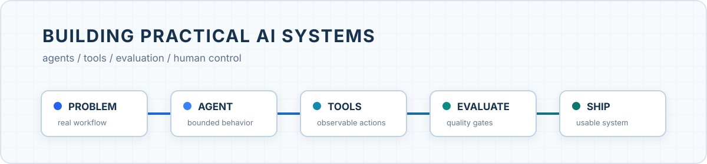

# Donna Gan

### AI Builder · Agent Systems · Developer Tools

*Others learn to talk to AI. I learn to run it.*

**I build practical AI systems and publish the work.**

By role, I am an AI product manager. In practice, I spend most of my time building agent workflows, developer tools, local-first apps, evaluation systems, and the glue that turns model output into something people can actually operate.

Most projects start with a messy workflow and end with a testable system: explicit boundaries, observable state, tool use, quality gates, and a human path when automation should stop.

## Featured build

### [AgentDock](https://github.com/bleakbelladonnals/AgentDock)

**A local-first AI conversation office for macOS.**

AgentDock brings local conversations from Codex Desktop, the VS Code Codex extension, and Hermes Desktop into one quiet workspace. It shows what is running, what needs attention, what ended, and why each state was inferred.

- **Evidence-first state:** every status is tied to observable local signals; uncertain sessions stay unknown instead of being guessed.
- **Return to the right conversation:** stable conversation IDs reopen the original Codex or VS Code thread.
- **Local by default:** read-only local data access, with credential reads and network requests kept off.

`Swift 6` · `macOS 14+` · `local-first` · `agent operations` · `MIT`

[**Explore AgentDock →**](https://github.com/bleakbelladonnals/AgentDock)

## More builds

| Project | What I am building | Focus |
|---|---|---|
| [**dsh-echo**](https://github.com/bleakbelladonnals/dsh-echo) | Record an MCP interaction once, then replay it safely inside DeepSeek Harness. | TypeScript · MCP · harness tooling |
| [**SEO Article Agent**](https://github.com/bleakbelladonnals/Seo-article-agent) | A multi-agent B2B content pipeline from research and planning to generation, review, and revision. | TypeScript · multi-agent workflows · quality gates |
| [**DocGate**](https://github.com/bleakbelladonnals/DocGate) | Local change-acceptance middleware that keeps human feedback, agent claims, real diffs, and review decisions separate. | human-in-the-loop · review workflows · traceability |
| [**Elec Sheep Longform**](https://github.com/bleakbelladonnals/elec-sheep-longform) | An agent skill for producing consistent educational carousels with editable SVG text, batch rendering, and visual QA. | JavaScript · agent skills · visual QA |
| [**ASR Transcription Skills**](https://github.com/bleakbelladonnals/asr-transcription-skills) | A field-tested skill suite for transcription pipelines, engine benchmarking, SRT post-processing, and learning-note generation. | Python · ASR · evaluation |

Also building [Artifact Harbor](https://github.com/bleakbelladonnals/dsh-artifact-harbor), [BondMemo](https://github.com/bleakbelladonnals/bondmemo), and small tools for learning, recovery, and agent-assisted work.

## Open-source contributions

I contribute by tracing user-facing failures back through documentation, source definitions, examples, and tests.

### Microsoft MCP

- [**PR #3386**](https://github.com/microsoft/mcp/pull/3386) — removed invalid `subscription` arguments from seven resilience-management examples. **Merged**
- [**PR #3387**](https://github.com/microsoft/mcp/pull/3387) — added `coding-agent` guidance while preserving valid usage paths and avoiding duplicate test coverage. **Merged**
- [**PR #3385**](https://github.com/microsoft/mcp/pull/3385) — refreshed global option descriptions against the current implementation. **Open**

## Product systems behind the code

| System | Problem space | System shape |
|---|---|---|
| **LumiAgent** | Product lookup, order breakdown, inventory checks, and purchasing gaps across sales, warehouse, and procurement. | Intent routing + RAG + structured tools + evaluation and fallback loops. Median product lookup time moved from 12 minutes to 2 minutes. |
| **LumaFlow** | B2B content operations with scattered product knowledge, inconsistent review criteria, and weak asset reuse. | Knowledge layer + five specialized agents + quality gates + human approval + versioned content assets. |
| **Microsoft MCP** | AI assistants generating commands from examples that had drifted away from the actual implementation. | Scenario review + source cross-checking + focused documentation fixes + repository validation. |
| **Zaowutai** | Non-technical users know the problem they want to solve but cannot turn it into product requirements or a usable tool. | Guided requirement clarification + explicit scope confirmation + an AI builder that delivers local-first tools. |

## Current focus

`Agent harnesses` · `MCP` · `Agent skills` · `Evaluation` · `Local-first AI` · `Human-in-the-loop systems`

**Build with:** TypeScript · Python · Swift · JavaScript · Next.js · NestJS

---

  Building AI systems that are useful, inspectable, and ready to be operated.

